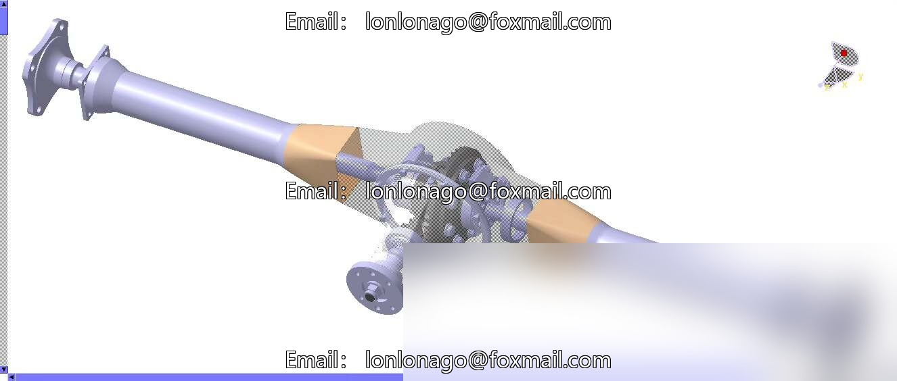
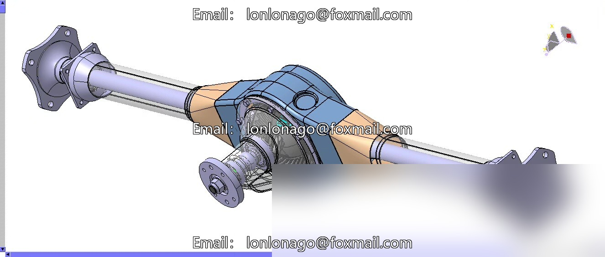
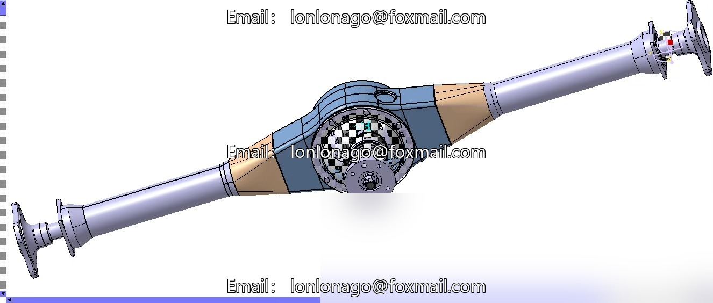
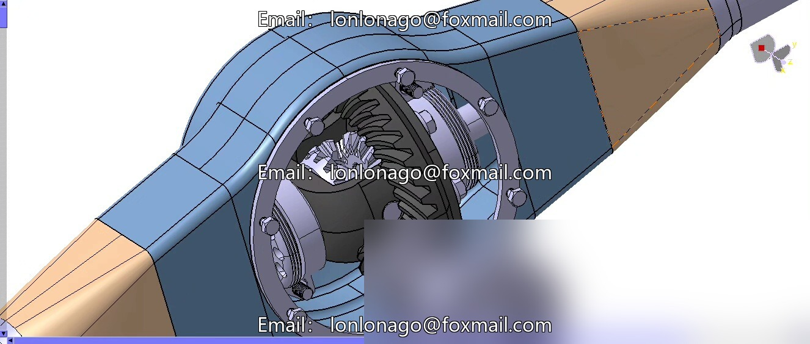
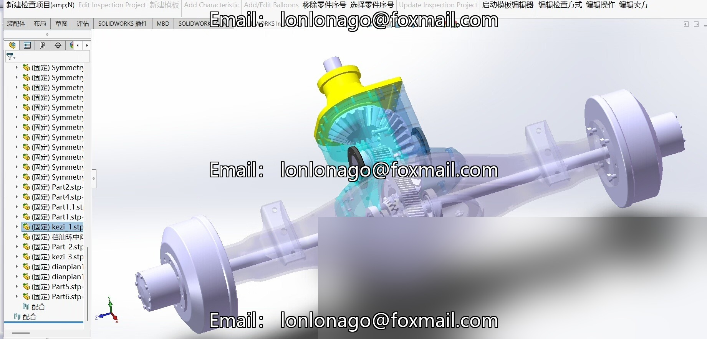

# Drive bridge design, drive bridge figure, double-click main reduction drive bridge design, model and simulation, drive bridge 3D

## Body

Drive beam design, drive beam drawing, double-click main reduction drive beam design, model and numerical simulation, drive beam 3D, drive beam data model, including 3D main reductioner and 3D differential
Multiple models, can be opened and edited with CATIA UG, SolidWorks, etc.
A041 There are other various types of 3D drawings, model and numerical simulation modification services, specific detailed discussion.

Drive bridge design content includes bridge diagrams, model data and 3D models, with support for opening and editing via CATIA UG SolidWorks; inspection projects, templates, assemblies and plugins are also offered.

<!-- AI_ENRICHED -->

## Images

## Payment

Here is a pay link on Stripe ( https://buy.stripe.com/3cs8yP7sY87d0vu9AB ). Please contact me lonlonago@foxmail.com after funding $89, and I will send you a complete data files , thank you!

